# LCARS Climate Dial

An LCARS-style thermostat dial for Home Assistant, running ESPHome on the **Open Nextion
ONX2424G013** round knob display. Turn the knob to set the temperature, press it to switch your
heating or cooling on and off. It works with any Home Assistant `climate` entity.

> [!IMPORTANT]
> **Unofficial fan project, for personal and non-commercial use only.**
> LCARS, Star Trek and all related names, marks and designs are the property of
> **Paramount Global / CBS Studios Inc.** This project is not affiliated with, endorsed by or
> sponsored by Paramount or CBS. It contains no official artwork or fonts: the look is drawn
> from scratch in code, and the text uses the free [Antonio](https://fonts.google.com/specimen/Antonio)
> font. Please don't sell it or anything made with it. See [Trademarks](#trademarks).

<p align="center">
  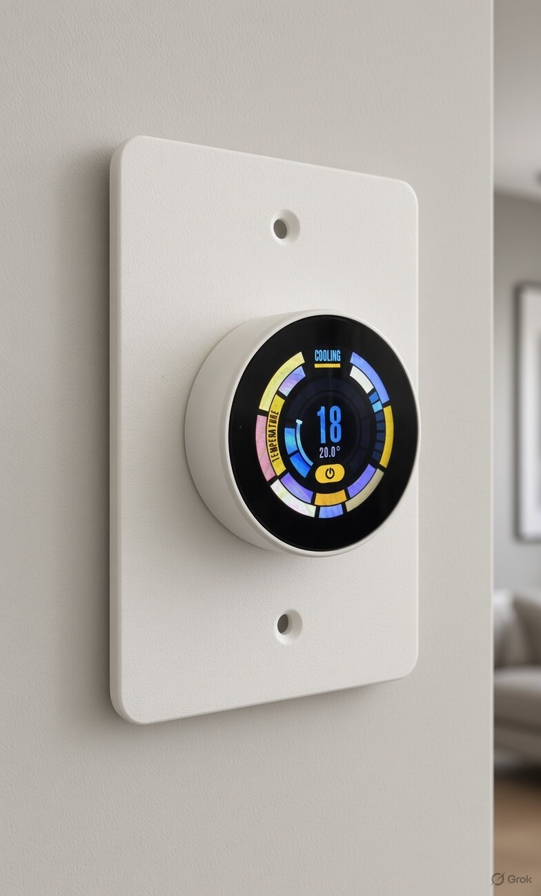
  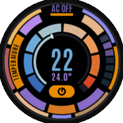
</p>
<p align="center"><sub>Left: concept render, AI-generated with Grok. It's not a photo of the actual build.
Right: the firmware running in the simulator.</sub></p>

<p align="center">
  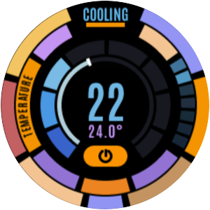
  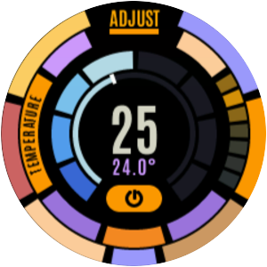
  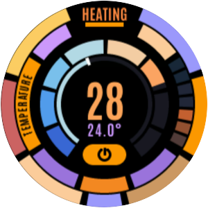
  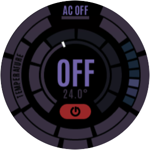
  
</p>

## What it does

- **Turn** to set the temperature (clockwise warmer). The set temperature is sent once the
  knob has been still for 0.7 s, so your air con gets one command instead of a beep per click.
  Spin it fast to move in bigger steps.
- **Press** to turn the climate device on or off.
- **Status at the top**: HEATING or COOLING (inferred from the mode and the temperatures),
  ADJUST while you turn, or AC OFF.
- **The gauge** fills from blue to orange with the set temperature. A notch marks the room
  temperature, which is also shown under the big number.
- **Sleep:** once it's off and left alone for 45 s, the screen dims and shows just the room
  temperature. Turning the knob wakes it; pressing it turns the climate back on.
- **Works with any climate entity:** the temperature range and step size come from the entity itself.

## Hardware

- **Open Nextion ONX2424G013**: ESP32-S3 (16 MB flash, 8 MB PSRAM), 1.28" 240×240 GC9A01
  round screen, rotary encoder with push button, USB-C.
- **Mounting:** a 3D-printable Australian-size [wall plate](#wall-plate) is included.
  The desk stand from [Nextion Desk Clock](https://github.com/atoulmin/nextion-desk-clock#desk-stand)
  holds the knob a quarter turn round, and this firmware doesn't have a rotation setting yet.

## Setup

### 1. Flash the firmware

Download `lcars-climate-dial-<version>.factory.bin` from the [latest release](../../releases/latest).
Plug the knob in over USB, then open [web.esphome.io](https://web.esphome.io) in Chrome or Edge.
Click **Connect**, then **Install**, and choose the file.

Or build it yourself with [ESPHome](https://esphome.io) 2026.7 or newer:

```sh
cd firmware
esphome run lcars-climate-dial.yaml --device /dev/ttyACM0
```

### 2. Connect it to Wi-Fi

The dial shows **WI-FI SETUP** and a QR code. Scan the QR code with your phone, or join the
**LCARS Dial Setup** Wi-Fi yourself. A setup page opens; pick your Wi-Fi and enter its password.
If the page doesn't open by itself, browse to any website. You can also set the Wi-Fi over USB at
[web.esphome.io](https://web.esphome.io).

### 3. Add it to Home Assistant

The dial now shows **ADD ME IN HOME ASSISTANT**. In Home Assistant, go to
**Settings → Devices & services**. Find **LCARS Dial** under *Discovered* and click **Add**.

You won't be asked for an encryption key. Home Assistant creates one and installs it on the dial
for you.

### 4. Choose your climate device

The dial now shows **SELECT A CLIMATE DEVICE**. Open the dial's device page in Home Assistant
(Settings → Devices & services → ESPHome → LCARS Dial) and do **both** of these:

1. **Allow it to control Home Assistant.** On the ESPHome card, click **Configure**, tick
   **Allow the device to perform Home Assistant actions**, and click **Submit**.
   *Without this the dial shows your climate but can't change it.*
2. **Set the climate entity.** Under **Configuration**, click the **Climate entity** box and type your
   climate's entity ID, for example `climate.living_room`. Then **press Enter**.
   *The value is only saved when you press Enter.*

You can find the entity ID under Settings → Devices & services → Entities: search for "climate"
and open the entity's settings.

After you press Enter, the dial restarts (about 5 seconds), links to your climate device and builds
up its display. If it shows a red **ALERT: NO RESPONSE FROM …** instead, check the entity ID for
typos, then press Enter again.

<p align="center">
  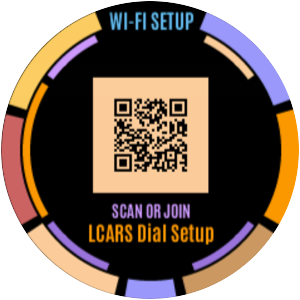
  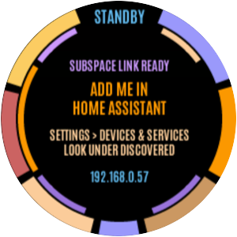
  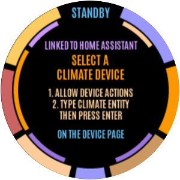
  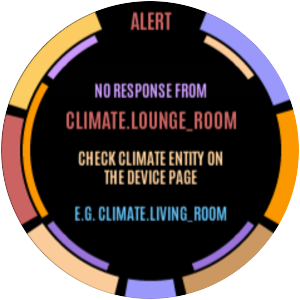
</p>

## Wall plate

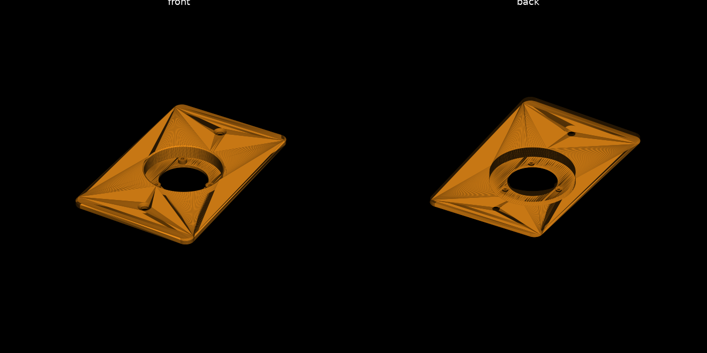

A standard Australian switch plate (73 × 115 × 4 mm) that holds the dial on a wall:
[`enclosures/wall-plate/onx2424g013_au_wallplate.stl`](enclosures/wall-plate/onx2424g013_au_wallplate.stl).

- **How it fits:** the knob's rear housing sits in a cup through the plate, with the turning
  ring 1 mm proud of the face so it turns freely. The cup reaches 8.4 mm into the wall.
- **Fixing the knob:** use 3 × M1.6 screws, about 6 mm long, put in from the back into the
  knob's own nuts.
- **Don't over-tighten:** if the screws are too tight, the knob's push button becomes stiff
  or stops clicking. Do them up gently, then press the knob. If the push feels stiff, back each
  screw off a little at a time until it presses smoothly. You can also use the screws to set
  how deep the knob sits.
- **Fixing the plate:** use 2 × M3.5 plate screws at the standard 84 mm centres, so it fits
  Australian wall boxes and mounting brackets.
- **Power:** a USB-C cable runs straight out of the back of the knob into the wall cavity,
  so you'll need USB power behind the plate. Very chunky plugs may be tight against the screw
  post beside the socket.
- **Printing:** print it face down, with no supports.
- **Changing it:** every dimension is a setting at the top of `make_plate.py`. To regenerate the STL, run
  `pip install -r enclosures/requirements.txt`, then `python make_plate.py` in that folder.

## Settings in Home Assistant

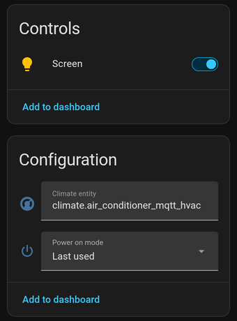

| Entity | |
|---|---|
| **Screen** | The display's backlight (on/off, brightness) |
| **Climate entity** | The climate device it controls. Type the ID and **press Enter**; the dial restarts to link to it |
| **Power on mode** | What a press turns the climate on as: **Last used** (the climate's own last mode), Heat/Cool, Auto, Heat or Cool |

**Why the restart?** Home Assistant only asks a device which entities it wants updates for when
it connects. A quick restart makes it ask again for the new entity.

<br clear="right">

## Customising

The settings at the top of `firmware/lcars-climate-dial.yaml`:

| Substitution | Default | |
|---|---|---|
| `temp_range_from_ha` | `"true"` | Use the climate entity's `min_temp`, `max_temp` and `target_temp_step`. Set to `"false"` to use `temp_min` / `temp_max` / `temp_step` instead |
| `send_after_ms` | `700` | How long the knob must be still before the temperature is sent |
| `screen_idle_after` | `45s` | How long until the screen sleeps once the climate is off |
| `sleep_brightness` | `0.3` | Backlight level on the sleep screen |
| `lcars_font`, `size_*` | Antonio | The font and its sizes; if you own an LCARS-style font, point `lcars_font` at its TTF and adjust the sizes |
| `setup_ssid` | `LCARS Dial Setup` | Name of the setup hotspot |

**Simulator:** `firmware/sim.yaml` runs the dial in a window on your computer
(`esphome run sim.yaml`). ↑/↓ turns the knob and Space presses it. `LCARS_DEMO=1` plays a demo,
and `LCARS_SETUP_DEMO=1` steps through the setup screens.

### Files

| File | |
|---|---|
| `firmware/lcars-climate-dial.yaml` | The firmware to flash |
| `firmware/lcars_climate_device.yaml` | Hardware, the Home Assistant climate link and the setup-screen logic |
| `firmware/lcars_climate_ui.yaml` | Fonts, knob handling and the animation loop |
| `firmware/lcars_climate.h` | The LCARS display, drawn in LVGL |
| `firmware/lcars_setup.h` | The setup screens |
| `firmware/sim.yaml` | Desktop simulator |
| `enclosures/wall-plate/` | Wall plate STL and the Python script that generates it |

## Trademarks

LCARS (Library Computer Access/Retrieval System), Star Trek and all related names, logos,
marks and designs are trademarks and/or copyrights of **Paramount Global** and **CBS Studios
Inc.** This is an unofficial, non-commercial fan project made for personal use. It is not
affiliated with, endorsed by or sponsored by Paramount Global, CBS Studios or any of their
affiliates. No official artwork, sounds or fonts are included. If you are a rights holder and
have a concern, please open an issue.

## Licence

The code and documentation are licensed under
[CC BY-NC-SA 4.0](https://creativecommons.org/licenses/by-nc-sa/4.0/): you may use, share and
adapt them for **personal, non-commercial purposes**, with credit, under the same licence.
The licence doesn't cover the LCARS and Star Trek trademarks above. The Antonio font is under the
SIL Open Font Licence 1.1 and is downloaded from Google Fonts at build time. See [LICENSE](LICENSE).
